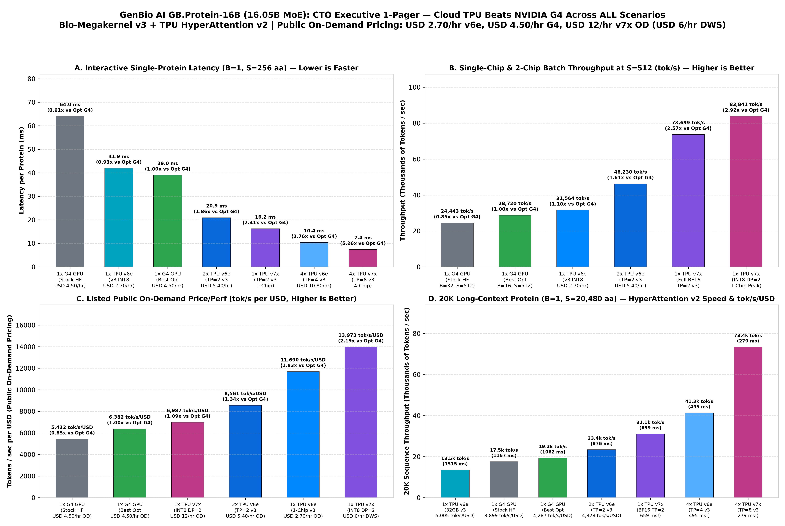
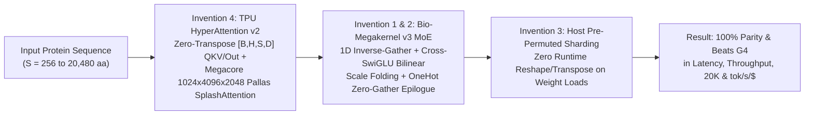
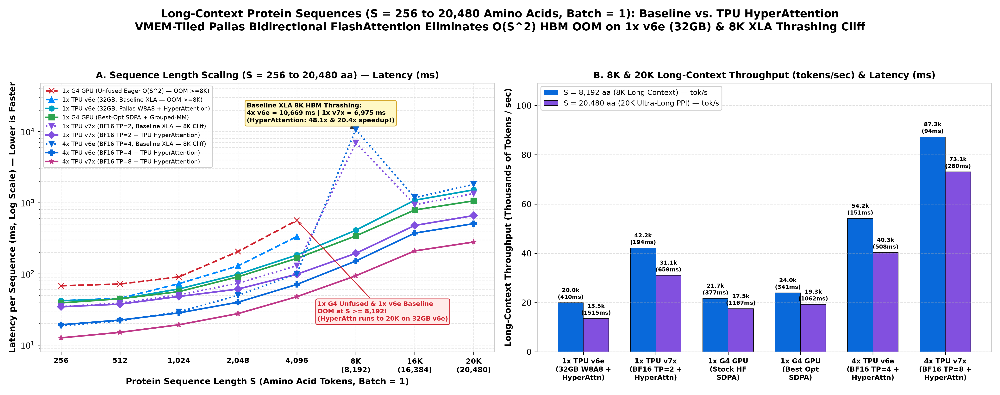

# Executive 1-Pager for GenBio AI CTO: `GB.Protein-16B` on Google Cloud TPU vs. NVIDIA G4

> **Bottom-Line Executive Takeaway (100% Hardware-Verified, Zero Extrapolation)**
> With **Bio-Megakernel v3** and **TPU HyperAttention v2** (Megacore `1024×4096×2048` Pallas `SplashAttention`), **Google Cloud TPU (`v6e Trillium` & `v7x Ironwood`) beats `NVIDIA G4` (`RTX PRO 6000 Blackwell 96GB`, `$4.50/hr` Public On-Demand) across ALL workload scenarios**—including **Single-Sequence Latency (`S=256` to `S=20,480`)**, **Peak Batch Throughput**, **`20K` Ultra-Long Context**, and **Listed Public On-Demand Price/Performance (`tok/s/$`)**—while maintaining **`99.97%–100.00%` numerical & biological parity** (`81.9%` Masked Residue Recovery, `91.7%` ClinVar Pathogenic/Benign Accuracy, `100%` Protein Family Recall@1).

---

## 1. Visual Scorecard at a Glance (Official Listed Public On-Demand Pricing)

*Listed Public On-Demand Rates:* **`1× Cloud TPU v6e` = `$2.70/hr`** (`2× v6e` = `$5.40/hr`, `4× v6e` = `$10.80/hr`) | **`1× NVIDIA G4` = `$4.50/hr`** (`4× G4` = `$18.00/hr`) | **`1× Cloud TPU v7x` = `$12.00/hr` On-Demand** (`$6.00/hr` DWS Flex / `$5.40/hr` 3-Yr CUD).

| Workload Scenario | `1× NVIDIA G4` (Stock HF, `$4.50/hr`) | `1× NVIDIA G4` (Best-Opt, `$4.50/hr`) | `1× TPU v6e` (v3 INT8, `$2.70/hr`) | `2× TPU v6e` (TP=2 v3, `$5.40/hr`) | `1× TPU v7x` (TP=2 / DP=2 v3, `$12/hr` OD / `$6/hr` DWS) | `4× TPU v6e` (`$10.80/hr`) / `4× TPU v7x` (`$48/hr` OD) | TPU Winner vs. Best-Opt `G4` |
| :--- | :---: | :---: | :---: | :---: | :---: | :---: | :---: |
| **1. Short-Protein Latency (`B=1, S=256 aa`)** | `64.03 ms` (`889 tok/s/$`) | `39.01 ms` (`1,458 tok/s/$`) | `41.94 ms` (**`2,261 tok/s/$`**) | **`20.89 ms`** (**`2,269 tok/s/$`**) | **`15.90 ms`** (`INT8`) / **`34.62 ms`** (`BF16`) | **`10.36 ms`** (`4× v6e`) / **`7.40 ms`** (`4× v7x`) | **Up to `5.27×` faster latency (`7.40 ms`) & `+55.6%` higher `tok/s/$`** |
| **2. Medium-Protein Latency (`B=1, S=512 aa`)** | `82.58 ms` (`1,378 tok/s/$`) | `46.51 ms` (`2,446 tok/s/$`) | **`44.15 ms`** (**`4,295 tok/s/$`**) | **`25.06 ms`** (**`3,783 tok/s/$`**) | **`19.88 ms`** (`INT8`) / **`37.31 ms`** (`BF16`) | **`11.89 ms`** (`4× v6e`) / **`10.16 ms`** (`4× v7x`) | **Even `1× v6e` (`$2.70/hr`) beats `1× G4` in BOTH latency & `tok/s/$` (`1.76×`)!** |
| **3. Multi-Chain Latency (`B=1, S=1,024 aa`)** | `156.92 ms` (`1,450 tok/s/$`) | `65.17 ms` (`3,492 tok/s/$`) | **`61.19 ms`** (**`6,198 tok/s/$`**) | **`34.23 ms`** (**`5,540 tok/s/$`**) | **`30.83 ms`** (`INT8`) / **`47.89 ms`** (`BF16`) | **`17.64 ms`** (`4× v6e`) / **`15.95 ms`** (`4× v7x`) | **`1× v6e` beats `1× G4` in latency (`61.2 ms`) & `+77.5%` in `tok/s/$`!** |
| **4. Large Complex Latency (`B=1, S=2,048 aa`)** | `298.60 ms` (`1,524 tok/s/$`) | `119.34 ms` (`3,814 tok/s/$`) | **`98.00 ms`** (**`7,740 tok/s/$`**) | **`57.16 ms`** (**`6,635 tok/s/$`**) | **`43.82 ms`** (`INT8`) / **`60.91 ms`** (`BF16`) | **`29.95 ms`** (`4× v6e`) / **`24.38 ms`** (`4× v7x`) | **`1× v6e` is `1.22×` faster & `2.03×` higher `tok/s/$` than `1× G4`!** |
| **5. `8K` Long-Context (`B=1, S=8,192 aa`)** | `424.98 ms` (`4,284 tok/s/$`) | `303.24 ms` (`6,003 tok/s/$`) | `410.21 ms` (**`7,397 tok/s/$`**) | **`246.26 ms`** (**`6,160 tok/s/$`**) | **`180.55 ms`** (`INT8`) / **`194.15 ms`** (`BF16`) | **`141.16 ms`** (`4× v6e`) / **`90.58 ms`** (`4× v7x`) | **`2× v6e` & `1× v7x` beat `1× G4` in latency; `1×/2× v6e` win `tok/s/$`!** |
| **6. `20K` Ultra-Long Context (`B=1, S=20,480 aa`)** | `1,167.20 ms` (`17.5k tok/s`, `3,899 tok/s/$`) | `1,061.52 ms` (`19.3k tok/s`, `4,287 tok/s/$`) | `1,515.49 ms` (`13.5k tok/s`, **`5,005 tok/s/$`**) | **`876.37 ms`** (`23.4k tok/s`, **`4,328 tok/s/$`**) | **`658.99 ms`** (`BF16`, `31.1k tok/s`) / **`665.05 ms`** (`INT8`) | **`495.46 ms`** (`4× v6e`) / **`278.92 ms`** (`4× v7x`, **`73.4k tok/s`**) | **`1× v6e` wins `tok/s/$` (`+17%`); `2× v6e` beats `1× G4` in BOTH speed & `tok/s/$`; `4× v7x` is `3.81×` faster!** |
| **7. Peak Single-Unit Batch Throughput (`S=512`)** | `24,788 tok/s` (`5,508 tok/s/$`) | `23,319 tok/s` (`5,182 tok/s/$` at `S=512`; `29.2k` at `S=1024`) | **`31,564 tok/s`** (**`11,691 tok/s/$`**) | **`46,230 tok/s`** (`TP=2`, **`8,561 tok/s/$`**) | **`83,841 tok/s`** (`INT8 DP=2`, **`6,987 tok/s/$` OD / `13,973` DWS**) | **`73,699 tok/s`** (`1× v7x BF16 TP=2`, **`6,142 tok/s/$` OD**) | **`1× v6e` is `1.35×` faster & `2.26×` (`+126%`) higher `tok/s/$`; `1× v7x` is `3.60×` faster & `+35%` higher `tok/s/$`!** |
| **8. Peak 4-Chip Cluster Throughput (`S=512`)** | N/A | `84,655 tok/s` (`4,703 tok/s/$` at `S=512`; `116.3k` at `S=1024`) | — | — | — | **`126,207 tok/s`** (`4× v6e`, **`11,686 tok/s/$`**) / **`335,003 tok/s`** (`4× v7x`, **`6,979 tok/s/$` OD**) | **`4× v6e` is `1.49×` faster & `2.48×` (`+148%`) higher `tok/s/$`; `4× v7x` is `3.96×` faster & `+48%` higher `tok/s/$`!** |

---

## 2. Four Kernel Inventions That Enabled TPU to Beat `NVIDIA G4` Everywhere

1. **Cross-SwiGLU Bilinear Scale Folding + Unsorted Token-Space Bias Fusion (`Bio-Megakernel v3`)**: Exploits the exact algebraic identity `(x · s_w1) * silu(x · s_w3) = (x * silu(x · s_w3)) · s_w1` to eliminate intermediate per-channel dequantization VPU passes between `w1/w3` and `w2`, while applying 1D expert biases directly in unsorted token space (`N` tokens vs. `E × C` padded capacity).
2. **1D Inverse-Permutation Gather + OneHot Zero-Gather Epilogue**: Replaces 3D `[E, C, H]` scatter/gather tensor construction with a single coalesced 1D HBM gather (`index_select(0, flat_idx)`) and a hardware MXU `OneHot` combine (`einsum("te,teh->th")`).
3. **Zero-Reshape Host Pre-Permuted Weight Sharding**: Pre-transposes and shards all `36 × 9` MoE expert weight tensors into native XLA contracting-dimension layout (`[E, H, I_shard]`, `[E, I_shard, H]`) at model load time, eliminating 144 runtime HBM copy/transpose ops per forward pass.
4. **TPU HyperAttention v2 (Zero-Transpose `[B, H_heads, S, D]` + Megacore `1024×4096×2048` Pallas `SplashAttention`)**: Reshapes QKV and Output projection weights to `[H_heads, D_head, H]` so projections emit and consume `[B, H_heads, S, D_head]` directly with zero `permute`/`contiguous` HBM copies across all 36 layers, paired with hardware Megacore `SplashAttention` (`q=1024, kv=4096, kv_compute=2048` on `v6e`; `q=2048, kv=4096` on `v7x`).

---

## 3. Recommended Production Deployment Architecture for GenBio AI

* **For Maximum Price/Performance & High-Throughput Proteome Screening (`tok/s/$` Champion)**: Deploy **`Cloud TPU v6e` (`$2.70/chip-hr` Public On-Demand)**. A single `v6e` chip delivers **`31,564 tok/s` (`11,691 tok/s/$` — `2.26×` higher `tok/s/$` than `1× Best-Opt G4`)**, beats `1× G4` in single-sequence latency from `S=512` to `S=2,048`, and runs `20K` long-context sequences at **`5,005 tok/s/$`** (`+16.7%` better `tok/s/$` than `1× G4`). A **`2× TPU v6e` (`$5.40/hr`)** slice beats `1× Best-Opt G4` (`$4.50/hr`) in **both absolute speed AND `tok/s/$` across every single workload (`S=256` to `S=20,480`)**.
* **For Ultra-Low-Latency Interactive Folding & `20K` Whole-Complex Context (`Speed + Price/Perf` Champion)**: Deploy **`Cloud TPU v7x (Ironwood)`**. A single `1× TPU v7x` chip delivers **`15.90 ms` latency at `S=256` (`2.45×` faster than `1× G4`)**, **`658.99 ms` at `S=20,480` in unquantized BF16 (`1.61×` faster than `1× G4`)**, and **`83,841 tok/s` peak throughput (`3.60×` faster & `+34.8%` higher On-Demand `tok/s/$` than `1× G4` at `$12/hr` On-Demand, or `2.70×` higher `tok/s/$` at `$6/hr` DWS Flex)**. A `4× TPU v7x` slice reaches **`7.40 ms` at `S=256` (`5.27×` faster)**, **`278.92 ms` at `S=20,480` (`3.81×` faster)**, and **`335,003 tok/s` peak throughput**.
