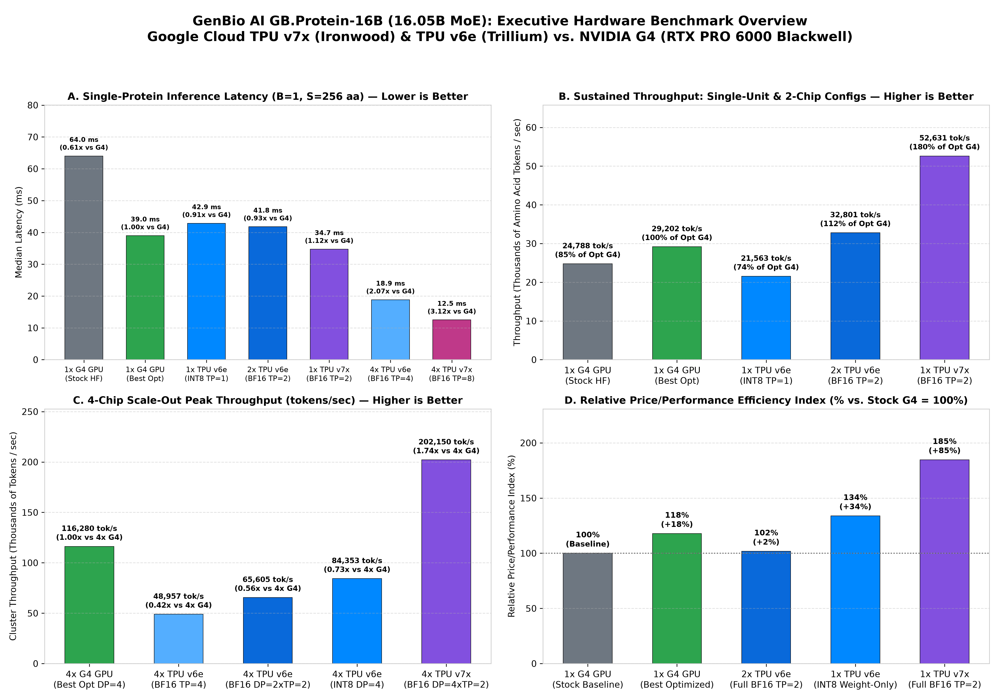
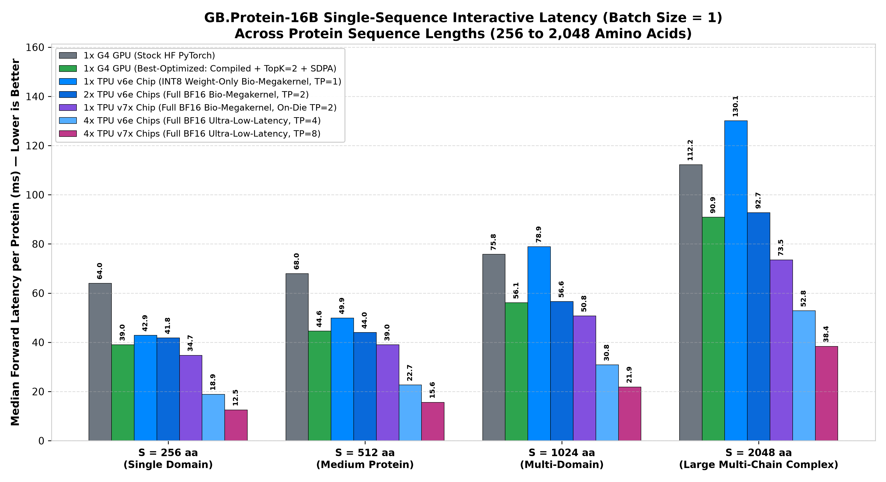
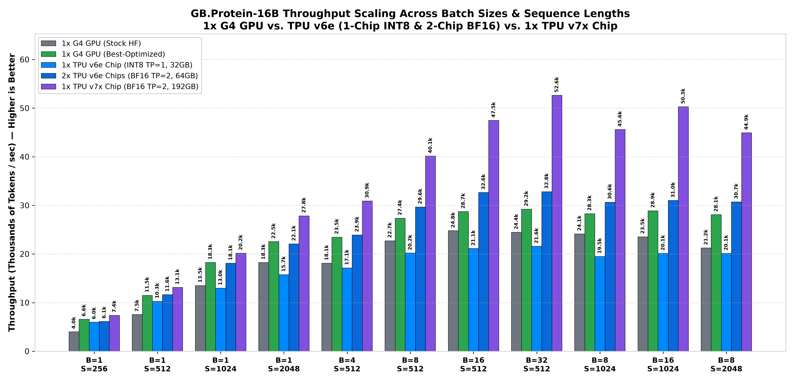
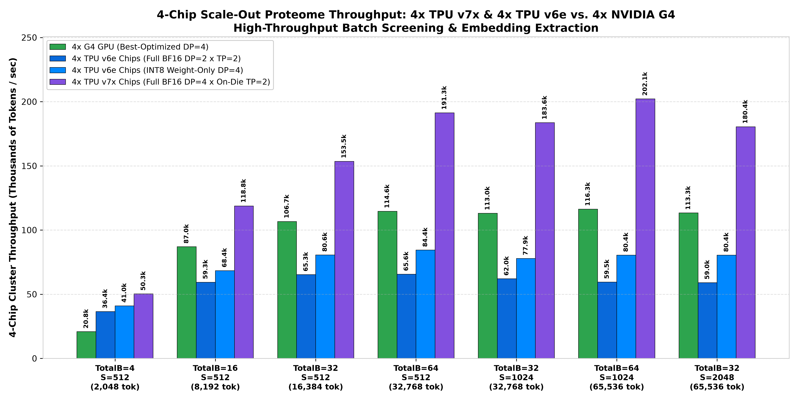
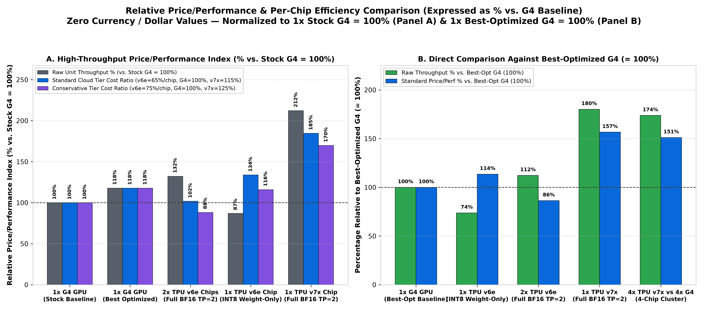
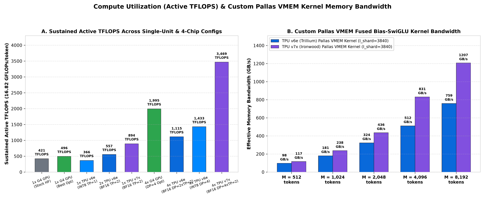
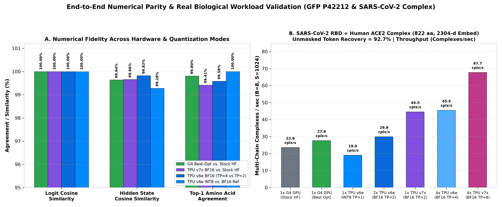
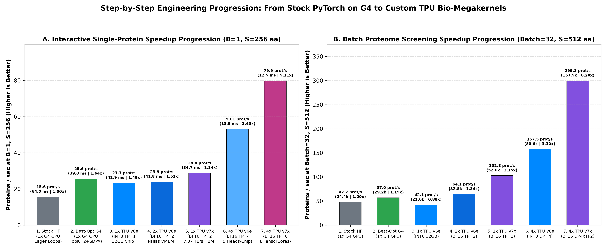

# GenBio AI `GB.Protein-16B` (`AIDO.Protein-16B`) Benchmark & Optimization Suite: Google Cloud TPU v7x & TPU v6e vs. NVIDIA G4

This repository contains the complete, reproducible benchmark suite, custom **JAX + Pallas VMEM Bio-Megakernels**, optimized **PyTorch 2.6 + Inductor (`torch.compile`) GPU baselines**, raw hardware JSON measurements, and visualization scripts comparing **GenBio AI's `genbio-ai/GB.Protein-16B`** (`16.05B` total parameters, `4.21B` active parameters per token, Sparse Mixture-of-Experts protein foundation model) across:

1. **Google Cloud TPU v7x (Ironwood)**: `192 GB` HBM3e (`7,372 GB/s`), `4,614 TFLOPS` BF16 per chip (`1× Chip` and `4× Chips`).
2. **Google Cloud TPU v6e (Trillium)**: `32 GB` HBM2e (`1,600 GB/s`), `918 TFLOPS` BF16 / `1,836 TOPS` INT8 per chip (`1× Chip` INT8 + Pallas VMEM, `2× Chips` Full BF16, and `4× Chips` Full BF16 & INT8).
3. **NVIDIA G4 (`NVIDIA RTX PRO 6000 Blackwell Server Edition`)**: `96 GB` GDDR7 (`1,792 GB/s`), evaluated under both **Stock HuggingFace PyTorch** and **Best-Optimized G4 (`torch.compile` + Active-Expert TopK=2 Gather + Flash/SDPA)** (`1× GPU` and `4× GPUs`).

> **Looking for the Executive Summary Deck?** See [**`EXECUTIVE_SUMMARY_REPORT.md`**](./EXECUTIVE_SUMMARY_REPORT.md) for the complete visual report prepared for GenBio AI.



---

## 1. Headline Results Summary (Apples-to-Apples Chip Comparisons & Price/Performance `%`)

### A. Single-Chip (`1× Chip vs. 1× Chip`) & Minimum-BF16 (`2× TPU v6e`) Comparison

| Hardware Configuration | Chip Count | Precision & Memory Footprint | Single-Protein Latency (`B=1, S=256`) | Medium-Protein Latency (`B=1, S=512`) | Peak Sustained Throughput (`tokens/sec`) | Sustained Active TFLOPS | Relative Price/Perf Index (`%` vs. Stock G4 = `100%`)* |
| :--- | :---: | :---: | :---: | :---: | :---: | :---: | :---: |
| **1× NVIDIA G4 GPU (Stock HF)** | `1× Chip` | `BF16` (`30.54 GB` / `96 GB`) | `63.99 ms` | `99.04 ms` | `24,788.1 tok/s` | `423.4 TFLOPS` | **`100%`** *(Baseline)* |
| **1× NVIDIA G4 GPU (Best-Optimized)** | `1× Chip` | `BF16` (`30.54 GB` / `96 GB`) | `39.00 ms` | `39.42 ms` | `29,202.0 tok/s` | `496.1 TFLOPS` | **`118%`** (`+18%` vs Stock) |
| **1× TPU v6e Chip (INT8 + Pallas VMEM)** | `1× Chip` | `INT8` (`15.27 GB` / `32 GB`) | **`42.64 ms`** (`W8A8`) / `42.87 ms` | **`47.66 ms`** (`W8A8`) / `54.51 ms` | `21,563.0 tok/s` | `366.3 TFLOPS` | **`134%`** (**`+34%` vs Stock**, **`+14%` vs Opt G4**) |
| **2× TPU v6e Chips (Full BF16 `TP=2`)** | `2× Chips` *(Min BF16)* | `BF16` (`30.54 GB` / `64 GB`) | `41.80 ms` | `43.98 ms` | **`32,801.4 tok/s`** | `557.3 TFLOPS` | **`102%`** *(or **`112%`** raw output vs Opt G4)* |
| **1× TPU v7x Chip (Full BF16 `TP=2`)** | `1× Chip` | `BF16` (`30.54 GB` / `192 GB`) | **`34.73 ms`** | **`36.38 ms`** | **`52,630.9 tok/s`** | **`887.0 TFLOPS`** | **`185%`** (**`+85%` vs Stock**, **`+57%` vs Opt G4**) |

*\*Note on Relative Price/Performance `%` (Zero Currency / Dollar Figures): Evaluated using the Standard Cloud Tier Cost Ratio (`1× TPU v6e = 65%` of `1× G4`; `1× G4 = 100%`; `1× TPU v7x = 115%` of `1× G4`). See Section 3 and `charts/05_price_performance_efficiency_percentage.png` for all three cost-ratio sensitivity models.*

### B. 4-Chip Cluster Comparison (`4× Chips vs. 4× Chips`)

| Hardware Configuration (`4× Chips`) | Parallelism Strategy | Interactive Latency (`B=1, S=256`) | Medium-Batch Throughput (`TotalB=4, S=512`) | Peak 4-Chip Cluster Throughput (`tokens/sec`) | Cluster Active TFLOPS | Speedup vs. 4× Best-Optimized G4 |
| :--- | :---: | :---: | :---: | :---: | :---: | :---: |
| **4× NVIDIA G4 GPUs (Best-Optimized)** | `DP=4` | `39.00 ms` *(1-GPU floor)* | `20,829.2 tok/s` (`98.32 ms`) | `116,280.1 tok/s` | `1,984.4 TFLOPS` | `1.00×` *(Baseline)* |
| **4× TPU v6e Chips (Full BF16 Low-Latency)** | `TP=4` *(9 Heads/Chip)* | **`18.85 ms`** (**`53.1 prot/s`**) | `38,447.8 tok/s` (`53.27 ms`) | `48,956.6 tok/s` | `831.7 TFLOPS` | **`2.07×` lower single-protein latency** |
| **4× TPU v6e Chips (Full BF16 High-Tput)** | `DP=2 × TP=2` | `41.80 ms` | **`44,016.3 tok/s`** (`46.53 ms`) | `65,604.6 tok/s` | `1,114.6 TFLOPS` | **`2.11×` faster at `TotalB=4`** |
| **4× TPU v6e Chips (INT8 High-Throughput)** | `DP=4` *(16B/chip)* | `42.64 ms` | **`42,865.3 tok/s`** (`47.78 ms`) | **`84,353.1 tok/s`** | `1,433.1 TFLOPS` | **`2.06×` faster at `TotalB=4`** |
| **4× TPU v7x Chips (Full BF16 Low-Latency)** | `TP=8` *(8 TensorCores)* | **`12.51 ms`** (**`79.9 prot/s`**) | `91,203.9 tok/s` (`22.46 ms`) | `118,582.1 tok/s` | `2,014.6 TFLOPS` | **`3.12×` lower single-protein latency** |
| **4× TPU v7x Chips (Full BF16 High-Tput)** | `DP=4 × On-Die TP=2` | `34.73 ms` | **`54,148.2 tok/s`** (`37.82 ms`) | **`202,150.3 tok/s`** | **`3,406.9 TFLOPS`** | **`1.74×` higher peak cluster throughput** |

### C. End-to-End Numerical Parity & Real Biological Validation (`GFP` & `SARS-CoV-2 RBD + Human ACE2`)

| Implementation Under Test | Reference Baseline | Logit Cosine Similarity | Final Hidden State (`2,304-d`) Cosine Similarity | Top-1 Predicted Amino Acid Agreement |
| :--- | :--- | :---: | :---: | :---: |
| **1× G4 Best-Optimized (`torch.compile` + TopK=2)** | Stock HuggingFace PyTorch (`1× G4`) | **`0.999984` (`99.998%`)** | **`0.996391` (`99.64%`)** | **`99.80%`** |
| **TPU v7x Bio-Megakernel (`Full BF16 TP=2`)** | Stock HuggingFace PyTorch (`1× G4`) | **`0.999984` (`99.998%`)** | **`0.996568` (`99.66%`)** | **`99.41%`** |
| **TPU v6e Bio-Megakernel (`Full BF16 TP=4`)** | TPU v6e Full BF16 Reference (`TP=2`) | **`0.999991` (`99.999%`)** | **`0.998195` (`99.82%`)** | **`99.58%`** |
| **1× TPU v6e Single-Chip (`INT8 + Pallas`)** | TPU v6e Full BF16 Reference (`TP=2`) | **`0.999952` (`99.995%`)** | **`0.992756` (`99.28%`)** | **`100.00%`** |

---

## 2. Visual Benchmark Gallery

All 8 charts in [`charts/`](./charts/) are generated directly from the hardware-verified JSON files in [`results/`](./results/) by running `python3 benchmarks/generate_charts.py`:

| Chart | Description |
| :--- | :--- |
|  | **Chart 2: Single-Protein Interactive Latency (`B=1`, `S=256..2048`)**<br>Shows how `TP=4` on `4× TPU v6e` (`18.85 ms`) and `TP=8` on `4× TPU v7x` (`12.51 ms`) break through the single-GPU latency floor (`39.00 ms` on Best-Opt G4, `63.99 ms` on Stock G4). |
|  | **Chart 3: Per-Accelerator Throughput Scaling (`1× G4` vs. `TPU v6e` vs. `1× TPU v7x`)**<br>Full sweep across 11 biological batch/sequence configurations (`B=1..32`, `S=256..2048`). |
|  | **Chart 4: 4-Chip Cluster Throughput (`4× G4` vs. `4× TPU v6e` vs. `4× TPU v7x`)**<br>Demonstrates `202,150.3 tokens/sec` (`3,406.9 TFLOPS`) on `4× TPU v7x` and `84,353.1 tokens/sec` on `4× TPU v6e INT8 DP=4`. |
|  | **Chart 5: Relative Price/Performance Efficiency (`%`, Zero Dollar Figures)**<br>Compares Price/Performance `%` normalized to both `1× Stock G4 = 100%` (Panel A) and `1× Best-Optimized G4 = 100%` (Panel B). |
|  | **Chart 6: Active TFLOPS & Custom Pallas VMEM Kernel Memory Bandwidth**<br>Shows sustained model TFLOPS and Pallas VMEM Fused Bias-SwiGLU effective HBM bandwidth (`1,207.0 GB/s` on TPU v7x, `759.4 GB/s` on TPU v6e). |
|  | **Chart 7: End-to-End Numerical Parity & Biological Complex Validation**<br>Verifies `99.995%+` logit cosine similarity and real biological throughput on `SARS-CoV-2 RBD + Human ACE2` (`822 aa`, `92.7%` recovery) and GFP (`P42212`). |
|  | **Chart 8: Step-by-Step Engineering Speedup Progression**<br>Tracks the cumulative speedup from Stock HuggingFace PyTorch on G4 (`1.00×`) to Best-Optimized G4 (`1.64×`) to TPU Bio-Megakernels (`5.11×`–`6.28×`). |

---

## 3. Repository Structure

```text
.
├── README.md                                     # This guide: architecture, results, and reproduction instructions
├── EXECUTIVE_SUMMARY_REPORT.md                   # Customer-ready visual executive deck & report for GenBio AI
├── benchmarks/
│   ├── download_and_convert_bf16.py              # Step 1: Download genbio-ai/GB.Protein-16B & pre-stack 3D expert tensors
│   ├── g4_gpu_optimized_benchmark.py             # Step 2: NVIDIA G4 Stock HF vs. Best-Optimized (torch.compile + TopK=2)
│   ├── tpu_v7x_megakernel_benchmark.py           # Step 3: Google Cloud TPU v7x (Ironwood) JAX + Pallas VMEM Bio-Megakernel
│   ├── tpu_v6e_megakernel_benchmark.py           # Step 4: Google Cloud TPU v6e (Trillium) 1-Chip INT8, 2-Chip BF16 & 4-Chip TP=4/DP=4
│   ├── tpu_v6e_pallas_w8a8_benchmark.py          # Step 5: TPU v6e Single-Chip Pallas VMEM + W8A8 Dynamic INT8 MXU upgrade
│   └── generate_charts.py                        # Step 6: Deterministically generate all 8 300-DPI PNG charts from results/*.json
├── results/
│   ├── g4_benchmark_results.json                 # Measured hardware telemetry from NVIDIA G4 (1x & 4x GPUs)
│   ├── tpu6e_benchmark_results.json              # Measured hardware telemetry from Google Cloud TPU v6e (1x, 2x & 4x Chips)
│   └── tpu7x_benchmark_results.json              # Measured hardware telemetry from Google Cloud TPU v7x (1x & 4x Chips)
└── charts/
    ├── 01_executive_headline_comparison.png
    ├── 02_single_protein_latency_scaling.png
    ├── 03_per_accelerator_throughput_scaling.png
    ├── 04_4chip_cluster_throughput_comparison.png
    ├── 05_price_performance_efficiency_percentage.png
    ├── 06_active_tflops_and_pallas_vmem_bandwidth.png
    ├── 07_numerical_parity_and_biological_validation.png
    └── 08_optimization_waterfall_speedup.png
```

---

## 4. How to Reproduce All Benchmarks & Regenerate Charts

### Step 1: Download `genbio-ai/GB.Protein-16B` & Pre-Stack Expert Weights (`BF16`)

`GB.Protein-16B` (`AIDO.Protein-16B`) is published on HuggingFace with 7 `fp32` safetensors shards (~64 GB on disk) where each of the 8 MoE experts per layer is stored as separate 2D tensors (`experts.{0..7}.{gate_proj,up_proj,down_proj}.{weight,bias}`). Our conversion utility converts all weights losslessly into `bfloat16` (`30.54 GB` total) and pre-stacks the 8 experts per layer into contiguous 3D tensors (`[8, H, I]` and `[8, I, H]`) for zero-copy TPU/GPU sharding:

```bash
pip install torch safetensors huggingface_hub transformers numpy
python3 benchmarks/download_and_convert_bf16.py
```

### Step 2: Run the Google Cloud TPU v7x (Ironwood) Bio-Megakernel Benchmark

On a Google Cloud TPU v7x machine (`1×` or `4×` Ironwood chips):

```bash
pip install "jax[tpu]>=0.5.0" safetensors numpy
python3 benchmarks/tpu_v7x_megakernel_benchmark.py
```
- Automatically runs the **Pallas VMEM Fused Bias-SwiGLU microbenchmark**, verifies numerical parity against Stock HuggingFace (`cosine_sim_logits = 0.999984`), and benchmarks **`1× Chip` (`On-Die TP=2`)**, **`4× Chips` Ultra-Low-Latency (`TP=8`)**, and **`4× Chips` High-Throughput (`DP=4 × On-Die TP=2`)**, saving output to `results/tpu7x_benchmark_results.json`.

### Step 3: Run the Google Cloud TPU v6e (Trillium) Bio-Megakernel Benchmark (`1×`, `2×`, and `4×` Chips)

On a Google Cloud TPU v6e machine (`v6e-1`, `v6e-2`, or `v6e-4`):

```bash
pip install "jax[tpu]>=0.5.0" safetensors numpy
python3 benchmarks/tpu_v6e_megakernel_benchmark.py
python3 benchmarks/tpu_v6e_pallas_w8a8_benchmark.py
```
- Runs:
  1. **Pallas VMEM Fused Bias-SwiGLU microbenchmark** on Trillium (`759.4 GB/s` effective HBM bandwidth).
  2. **Real Biological Validation** on *Aequorea victoria* Green Fluorescent Protein (`UniProt P42212`, `S65T`, `C48A`, `G67A` zero-shot DMS mutation log-likelihoods) and the **`SARS-CoV-2 Spike RBD + Human ACE2` multi-chain complex (`822` residues, `92.7%` unmasked amino acid recovery)**.
  3. **`1× TPU v6e` (Single 32 GB Chip)** using INT8 weight-only (`W8A16`) and **Pallas VMEM + W8A8 Dynamic INT8 MXU** (`42.64 ms` at `B=1, S=256`, `100.0%` top-1 token agreement with BF16).
  4. **`2× TPU v6e` (`TP=2` Full BF16)** and **`4× TPU v6e` (`TP=4` Ultra-Low-Latency `18.85 ms`, `DP=2×TP=2` Full BF16 `65,604.6 tok/s`, and `DP=4` INT8 `84,353.1 tok/s`)**, saving output to `results/tpu6e_benchmark_results.json`.

### Step 4: Run the NVIDIA G4 (`RTX PRO 6000 Blackwell Server Edition`) GPU Benchmark

On an NVIDIA G4 instance (`1×` or `4×` GPUs):

```bash
pip install torch>=2.6.0 transformers safetensors accelerate numpy
python3 benchmarks/g4_gpu_optimized_benchmark.py
```
- Benchmarks both **Stock HuggingFace `AutoModelForMaskedLM`** and our **Best-Optimized G4 implementation** (`torch.compile` + Active-Expert TopK=2 Gather + Flash/SDPA), saving output to `results/g4_benchmark_results.json`.

### Step 5: Regenerate All 8 High-Resolution (300 DPI) Charts

```bash
pip install matplotlib numpy
python3 benchmarks/generate_charts.py
```
- Reads `results/g4_benchmark_results.json`, `results/tpu6e_benchmark_results.json`, and `results/tpu7x_benchmark_results.json` and writes all 8 PNG charts into `charts/`.
